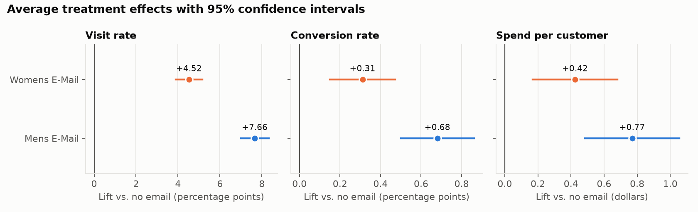
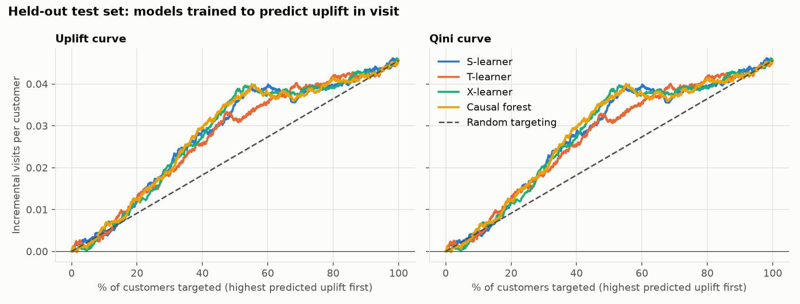
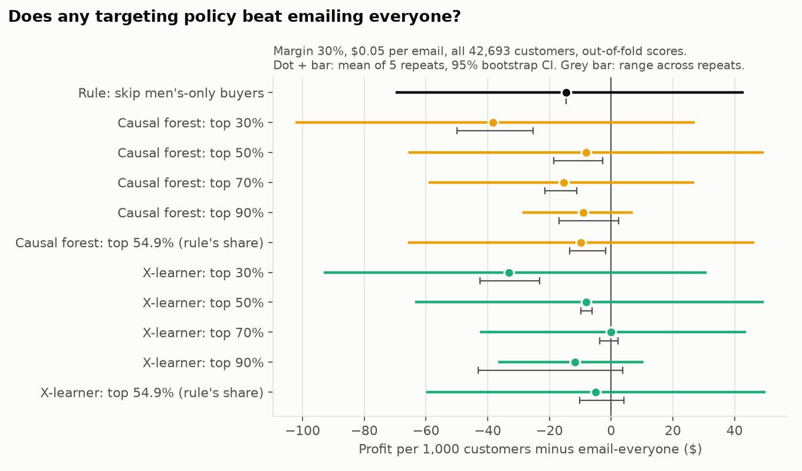
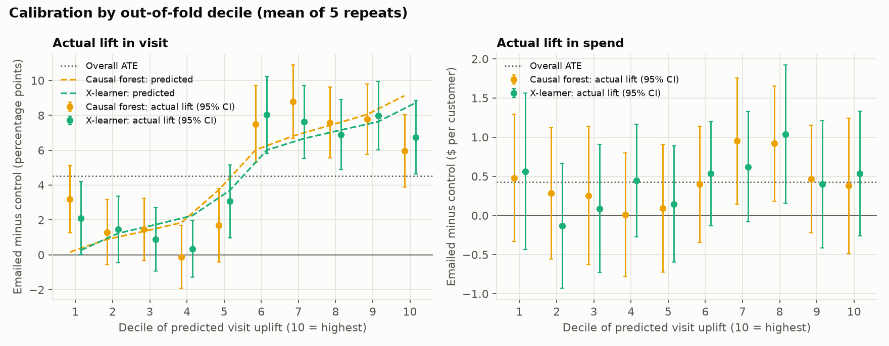

# Who should get the email? Targeting and uplift on the Hillstrom experiment

Final report. Detail for every number is in the phase reports:
[1 EDA](phase1_eda.md) · [2 uplift models](phase2_uplift.md) ·
[3 policy](phase3_policy.md) · [4 robustness](phase4_robustness.md) ·
[4b three-arm](phase4b_three_arm.md). Where phases disagree, this report
quotes the later one and says the earlier result was revised.

## 1. The question

An online retailer has two marketing emails, one featuring men's merchandise
and one featuring women's. **How should it use them, and does targeting beat
emailing everyone?** "Targeting" means choosing recipients by predicted
*incremental* response: the customers who buy because of the email, not the
ones who would have bought anyway.

The work started with the narrower question (who should get the women's
email?) and widened to the choice between the two emails once the first
answer was in. The report follows that order.

## 2. Data and design

The Hillstrom dataset (2008): 64,000 customers who bought in the previous
twelve months, **randomly assigned** one third each to the men's email, the
women's email, or no email. Outcomes were recorded for two weeks.

Randomization is what makes this a causal analysis. A coin flip cannot be
related to anything about a customer, so the three groups are alike on
average in every respect, recorded or not, and any difference in outcomes is
the effect of the email. The checks support it: arm sizes match equal thirds
(p = 0.90), the largest standardized difference on any covariate is 0.016
(conventional threshold 0.1), and the covariates jointly cannot predict the
arm (p = 0.89).

## 3. Metrics

- **Visit, conversion, spend** in the two weeks after the send.
- **Profit = margin × incremental revenue − cost per email × emails sent**,
  per 1,000 customers. Spend is revenue, not profit.
- **Margin and cost are not in the data.** The base case assumes 30% and
  $0.05, with a sensitivity grid of 20/30/50% × $0.01/$0.05/$0.10.

## 4. Method

**Uplift models.** Four models estimate how much the women's email changes
each customer's behaviour, using only the eight pre-treatment covariates:

- *S-learner:* one outcome model with the email as a feature. Simple, but
  can ignore a weak treatment signal.
- *T-learner:* separate models for emailed and control customers,
  subtracted. Their independent errors can look like heterogeneity.
- *X-learner:* a T-learner plus a second stage that models the imputed
  individual effects directly.
- *Causal forest:* trees that split to separate customers by treatment
  effect, with honest estimation.

**Evaluating a ranking.** Individual uplift is never observed, so customers
are ranked by predicted uplift and, within the top k%, emailed and control
customers are compared. Qini and uplift curves trace that out; AUUC
summarises it against random targeting. This was done first on one 30%
held-out test set, then on all customers using 5 × 5 repeated
cross-fitting, in which every customer is scored by a model that never saw
them.

**Valuing a policy.** The model only decides *who* is targeted. The value of
a policy is always estimated from actual outcomes in the experiment, by
inverse propensity weighting with the known assignment probabilities, never
from the model's own predictions. All comparisons use paired bootstrap
intervals.

## 5. Results

### 5.1 Both emails work on average

| Email vs. no email | Visit | Conversion | Spend per customer |
|---|---|---|---|
| Men's | +7.66 pp [7.00, 8.32] | +0.68 pp [0.50, 0.86] | +$0.77 [$0.49, $1.05] |
| Women's | +4.52 pp [3.89, 5.16] | +0.31 pp [0.15, 0.47] | +$0.42 [$0.17, $0.68] |

All six effects survive a multiple-comparison correction. Spend is far
noisier than visits: only 578 of 64,000 customers bought anything.

### 5.2 Models can rank who *visits* because of the women's email, not who *spends*

*Single 30% test set from Phase 2; the numbers below are the cross-fitted
ones.*

- **Visit:** both models carried forward beat random ranking clearly. AUUC
  above random is +0.0068 [0.0051, 0.0085] for the causal forest and +0.0073
  [0.0056, 0.0090] for the X-learner, about 30% more area than random.
- **The models are statistically tied** (p = 0.16). The forest was carried
  forward for its steadier predictions, not because it won.
- **Spend:** not established. Neither model's revenue ranking beats random
  (p = 0.34 and 0.23). An early hint that it did (p ≈ 0.04 on the single
  test set) was revised away by cross-fitting.
- One textbook failure appeared: the S-learner trained on spend predicted
  exactly zero uplift for everyone.

### 5.3 A result that did not survive: "email the top 90%"

On the single test set, dropping the 10% of customers with the lowest
predicted uplift beat emailing everyone by **+$38 per 1,000** (95% CI [$8,
$76]). It was flagged at the time as resting on 8 buyers (2 emailed, 6
control), on a test set that had also been used to choose the model and the
cut-off.

Cross-fitting on all 42,693 women's-email and control customers revised it
to **−$9 per 1,000 [−$28, +$7]**. The result did not replicate. With every
customer in play, that bottom decile has about 13 emailed buyers against 10
control.

**No targeting policy for the women's email beats emailing everyone.** Every
point estimate is zero or negative and every interval includes zero.
Emailing everyone the women's email earns about $77 per 1,000 customers at
the base case, which is itself borderline (the interval sits just either
side of zero depending on the method) and unproven at $0.10 per email.

### 5.4 What the models actually found: one variable

- The visit effect of the women's email has essentially **two levels**:
  about +7.3 pp for customers who bought women's merchandise last year and
  +1.1 pp for those who bought only men's.
- Within each level the model's ranking carries no visible signal. The top
  decile is the weakest of the top five.
- At the same email volume, **99.4% of the customers the forest excludes are
  men's-only buyers.** The model's edge over the one-line rule "skip
  men's-only buyers" is $5 to $9 per 1,000 customers.
- In *spend*, even the gap between those two groups is not significant
  (+$0.27, p = 0.32), and men's-only buyers show no negative effect.

### 5.5 The bigger finding: which email matters more than who gets it

Using the men's-email arm and three pre-specified segments (no model):

- **The men's email works about equally in every segment:** +6.9 pp visits
  for men's-only buyers and +7.1 pp for women's-only buyers (difference
  p = 0.84).
- **The women's email is the one that depends on purchase history.** For
  women's-only buyers the two emails are tied.

| Policy (base case) | Profit per 1,000 | 95% CI |
|---|---|---|
| Email no one | $0 | – |
| Women's email to everyone | $77 | [$1, $153] |
| Matched rule (men's to men's-only, women's to the rest) | $131 | [$55, $211] |
| Men's email to everyone | $181 | [$98, $264] |

- Men's-to-everyone beats women's-to-everyone by **$104 per 1,000 [$8,
  $198], p = 0.031**. That is suggestive on spend (0.093 after correcting
  for three policy comparisons) and not in doubt on visits and conversions
  (both p < 0.001).
- The matched rule is not established as better or worse than either
  single-email policy (p = 0.097 and 0.17).
- **Important caveat: "men's" and "women's" are two different creatives.**
  They may differ in offer, design, subject line or products, not only in
  department. The data cannot tell "men's merchandise emails work better"
  from "this particular email was better".

## 6. Recommendation

**TODO (author to write).** Findings to draw on:

- Both emails raise visits, conversions and spend on average; randomization
  holds.
- For the women's email, no targeting policy beats emailing everyone. The
  one that appeared to (top 90%, +$38) did not replicate (−$9 [−$28, +$7]).
- Uplift models rank visit response well but mostly rediscover one rule
  (men's-only buyers respond little to the women's email); their edge over
  that rule is $5–$9 per 1,000.
- Heterogeneity in *spend* response is not established anywhere in this
  data.
- The men's email to everyone has the highest estimated profit of the
  pre-specified policies ($181 per 1,000 vs. $77 for the women's email);
  the gap is suggestive on spend (p = 0.031), strong on visits and
  conversions.
- The men's email's advantage may be about that creative, not the
  department.
- Emailing is clearly profitable at $0.01 per email; at $0.10 the women's
  email is unproven, while the men's email clears zero in eight of nine
  margin × cost scenarios.
- All dollar figures depend on an assumed margin and cost, and on a two-week
  window.

## 7. Caveats and next steps

- **Small spend sample.** 578 buyers in total. The largest pre-specified
  contrast in spend lift for the women's email (+$0.27) has a standard error
  of $0.26; detecting it with 80% power would take roughly eight times this
  sample. This data can show who *visits* because of an email, not who
  *spends more* because of it.
- **Creative vs. department.** One version of each email, sent once. The
  men's email's advantage cannot be attributed to its subject matter.
- **Assumed margin and cost.** Neither is in the data. A flat cost ignores
  unsubscribes and list fatigue, which would favour sending fewer emails.
- **Two-week window.** Pulled-forward purchases count as incremental;
  longer-run harm from irrelevant emails is invisible.
- **2008 data, past-year buyers only, eight coarse covariates.** The method
  transfers; the effect sizes may not.
- **Many comparisons across five phases.** Isolated p-values near 0.05
  appeared and then vanished more than once.
- **No uplift model was fit for the men's email**, because its effect is
  flat across the segments tested.

**Next experiment.** Confirm men's-to-everyone in a fresh randomized test:

- Arms: no email, men's email, women's email, and if possible a 2 × 2 of
  creative template × department featured, to separate the creative from
  the merchandise.
- A longer outcome window (8–12 weeks) with unsubscribes and complaints
  tracked, so profit can include list damage.
- Sizing: the men's-vs-women's spend gap observed here ($0.35, standard
  error $0.16 at about 21,300 per arm) would need roughly 36,000 customers
  per arm for 80% power, and more if the true gap is smaller than the
  observed one, which is likely for a result selected because it looked
  large. This is a rough calculation, not a design.

## 8. Is this causal?

Yes, for the comparisons made here, because assignment was random. That
covers the average effects, the effects inside any subgroup defined by
pre-treatment data (including "the model's top 30%"), and the policy values.
It does not cover any individual's effect, or settings beyond this
population, these two emails and this window.

To show what randomization buys, Phase 4 built a **simulated** observational
dataset from the experiment by discarding rows so that big spenders were
much more likely to be emailed, as if marketers had chosen them. The true
effect is still the experimental one, so any gap is pure confounding:

| Estimator (effect on visits; truth = 4.52 pp) | Mean estimate | Bias |
|---|---|---|
| Naive difference in means | 6.29 pp | +39% |
| IPW, propensity model includes spending history | 4.43 pp | −2% |
| IPW, propensity model lacks spending history | 5.12 pp | +13% |

- The naive comparison credits the email with behaviour that comes from
  emailing richer customers.
- Adjusting for the confounder fixes it.
- **When the confounder is unmeasured, adjustment does not fix it.** Other
  covariates act as proxies and cut the bias from 39% to 13%, but do not
  remove it, and nothing in the data would warn the analyst.
- On spend the simulation is too noisy to show the same failure, which is
  itself a fair summary of the spend outcome.

Adjustment only corrects for what was measured. Randomization corrects for
everything, which is why this project can make causal claims at all.
