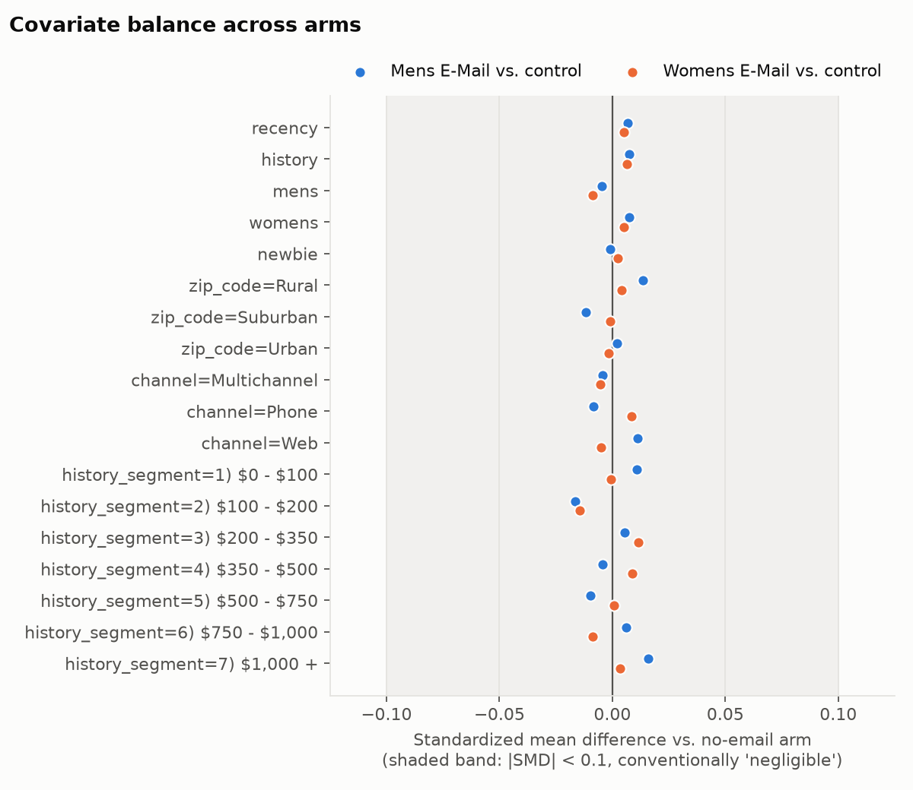
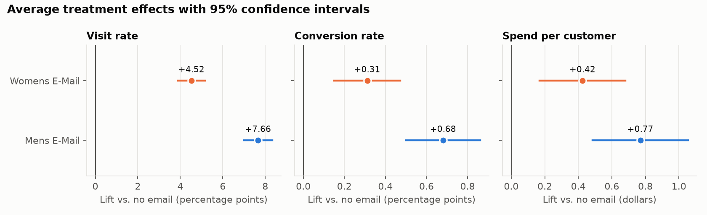

# Phase 1: Randomization check and baseline treatment effects

Reproduce with `python -m src.phase1_eda`. Every number below comes from
`reports/tables/phase1_*.csv`.

## 1. The data at a glance

- 64,000 customers, 12 columns, no missing values.
- Arms: 21,306 no email, 21,307 men's email, 21,387 women's email. A
  chi-square test against equal thirds gives p = 0.90, so the arm sizes are
  consistent with a 1/3–1/3–1/3 design.
- There is no customer ID. 6,562 rows are exact duplicates of another row, but
  these are most likely not duplicated customers (there is no ID to confirm
  it): 7,947 customers share the minimum
  `history` value of exactly $29.99, and with only a handful of coarse
  covariates many of them coincide on everything. Nothing was dropped.
- Outcomes are internally consistent: all 578 customers with `spend > 0` have
  `conversion = 1`, and every converter has `visit = 1`.
- Spend among buyers ranges from $29.99 to $499.00 (median $80.80).

## 2. Did randomization work?

Three checks, from most to least granular.

**Standardized mean differences (SMD).** For each covariate, the difference in
means between an email arm and control, divided by the pooled standard
deviation. The largest absolute SMD across all 18 covariate levels and both
email arms is **0.016** (`history_segment = $100–$200`, men's email vs.
control). The conventional threshold for a negligible imbalance is 0.1.

**Per-covariate tests across the three arms.** ANOVA for numeric covariates,
chi-square for categorical ones.

| Covariate | Test | p-value |
|---|---|---|
| recency | ANOVA | 0.763 |
| history | ANOVA | 0.698 |
| mens | chi-square | 0.672 |
| womens | chi-square | 0.729 |
| newbie | chi-square | 0.934 |
| zip_code | chi-square | 0.579 |
| channel | chi-square | 0.458 |
| history_segment | chi-square | 0.358 |

The smallest p-value is 0.36. None is close to significance even before any
multiple-comparison correction.

**Joint test.** A multinomial logit predicting the arm from all covariates
except `history_segment` (excluded because it is a binned copy of `history`),
compared with an intercept-only model: likelihood-ratio statistic 11.13 on 18
degrees of freedom, **p = 0.89**, McFadden pseudo-R² = 0.00008. The 18 degrees of freedom are 9 predictor
columns (recency, history, mens, womens, newbie, two zip-code dummies, two
channel dummies) times 2 non-reference arms. The covariates have essentially
no ability to predict who got which email.

**Conclusion.** No evidence against successful randomization. One honest
limit: balance tests can only examine *observed* covariates. That unobserved
ones are balanced too is something we believe because of the random
assignment mechanism, not something these tests prove.

## 3. Average treatment effects

Difference in means against the no-email arm, with Welch standard errors and
95% confidence intervals. Outcomes are measured in the two weeks after the
send.

| Email | Outcome | Control | Treated | ATE | 95% CI | Relative lift | p-value |
|---|---|---|---|---|---|---|---|
| Men's | Visit | 10.62% | 18.28% | +7.66 pp | [7.00, 8.32] | +72% | 2.7e-113 |
| Men's | Conversion | 0.573% | 1.253% | +0.681 pp | [0.500, 0.861] | +119% | 1.5e-13 |
| Men's | Spend / customer | $0.653 | $1.423 | +$0.770 | [0.485, 1.055] | +118% | 1.2e-07 |
| Women's | Visit | 10.62% | 15.14% | +4.52 pp | [3.89, 5.16] | +43% | 1.9e-44 |
| Women's | Conversion | 0.573% | 0.884% | +0.311 pp | [0.150, 0.472] | +54% | 1.6e-04 |
| Women's | Spend / customer | $0.653 | $1.077 | +$0.424 | [0.169, 0.680] | +65% | 1.1e-03 |

What this does and does not show:

- **Both emails work on average, on all three outcomes.** All six effects
  remain significant after a Bonferroni correction for six comparisons (the
  largest adjusted p-value is 0.0068, women's email on spend).
- **Precision falls sharply from visit to spend.** The women's-email visit
  effect is known to about ±14% of its size; its spend effect is +$0.42 with
  a CI from $0.17 to $0.68, about ±60% of its size. The sign is clear; the
  magnitude is not.
- **The spend result does not depend on the normal approximation.** Spend is
  99.1% zeros with a long right tail, so the CI was re-computed with a
  percentile bootstrap (5,000 resamples): men's [$0.479, $1.049], women's
  [$0.159, $0.684]. These are close to the analytic intervals.
- **Covariate adjustment changes nothing material.** Regression-adjusted
  estimates (Lin's interacted OLS, HC2 errors) differ from the raw ones by
  at most 0.053 pp for visit (men's: 7.606 vs. 7.659 pp; women's: 4.541 vs.
  4.523 pp), at most 0.003 pp for conversion (men's: 0.677 vs. 0.681 pp), and
  at most $0.003 for spend (men's: $0.767 vs. $0.770). The standard errors
  shrink by less than 2%. That is what a well-randomized experiment looks
  like, and it also says these covariates explain very little outcome
  variance.

### Men's email vs. women's email

| Outcome | Women's | Men's | Men's − Women's | 95% CI | p-value |
|---|---|---|---|---|---|
| Visit | 15.14% | 18.28% | +3.14 pp | [2.43, 3.84] | 3.6e-18 |
| Conversion | 0.884% | 1.253% | +0.369 pp | [0.174, 0.564] | 2.1e-04 |
| Spend / customer | $1.077 | $1.423 | +$0.345 | [0.033, 0.658] | 0.030 |

The men's email clearly drives more visits and conversions on average. For
spend the evidence is weaker: p = 0.030 on its own, which would not survive a
Bonferroni correction across these three comparisons (0.091). "Men's email
earns more per customer" is suggestive, not established.

### Where spend comes from (descriptive)

| Arm | Customers | Buyers | Conversion rate | Mean spend per buyer | Median spend per buyer |
|---|---|---|---|---|---|
| No email | 21,306 | 122 | 0.573% | $114.00 | $88.37 |
| Men's email | 21,307 | 267 | 1.253% | $113.53 | $66.98 |
| Women's email | 21,387 | 189 | 0.884% | $121.89 | $94.71 |

Mean basket size among buyers is similar across arms, so the spend lift
appears to come from *more people buying* rather than from bigger baskets.
This table is descriptive, not causal: buying is itself affected by the email,
so "buyers" are different sets of people in each arm.

## 4. What this means for the next phases

1. **The estimates can be read causally.** Randomization holds, so differences
   between arms are effects of the email.
2. **Emailing everyone is probably already a strong baseline.** The average
   effect on spend is positive for both emails (+$0.42 to +$0.77 per
   customer). But spend is revenue, not profit: the fair comparison is
   *margin × spend lift* against cost per email, and the dataset contains
   neither margin nor cost. At a 30% margin, for example, the women's email
   earns about $0.13 of incremental margin per customer, and the low end of
   its confidence interval is about $0.05. Against a cost of a few cents,
   "email everyone" most likely beats "email no one", so targeting has to
   beat *that*, not the do-nothing option. Phase 3 will make both margin and
   cost explicit parameters.
3. **Spend will be a hard target for uplift models.** There are only 578
   buyers in total, and 311 in the women's-vs-control comparison planned for
   Phase 2 (189 treated, 122 control). After a train/test split, the test set
   will hold on the order of 100 buyers. Expect noisy spend-uplift estimates
   and wide intervals on any revenue comparison. Visit has far more signal
   (about 5,500 visitors in that comparison) but is one step removed from
   revenue.
4. **The covariates are few and coarse** (eight, mostly categorical). Whatever
   heterogeneity in treatment effect exists has to show up through them.
