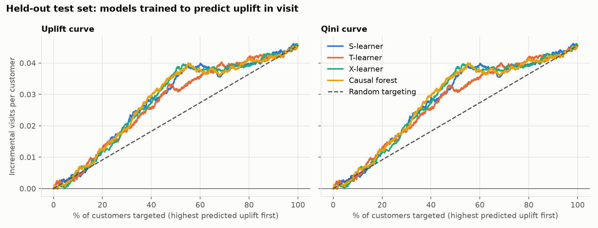
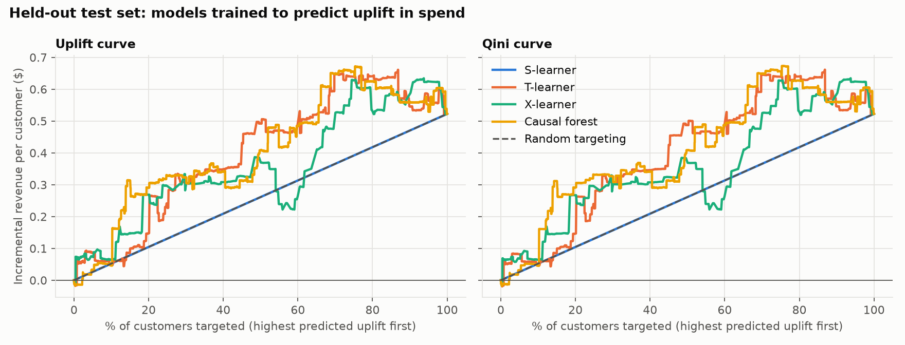
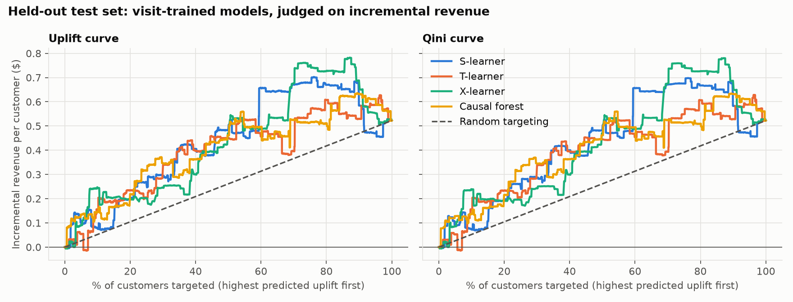

# Phase 2: Uplift modelling (women's email vs. control)

Reproduce with `python -m src.phase2_uplift`. Every number below comes from
`reports/tables/phase2_*.csv`. Model explanations live as docstrings in
[`src/learners.py`](../src/learners.py); the evaluation logic is explained in
[`src/evaluation.py`](../src/evaluation.py).

## 1. Setup

**Question for this phase.** Phase 1 showed the women's email works *on
average*. Can a model rank customers by *how much* it works for them, well
enough to beat picking customers at random?

**Data.** Women's-email and control arms only: 42,693 customers.

**Split.** One 70/30 split (seed 42), stratified on treatment × conversion.
The test set is used only for evaluation.

| Split | Arm | Customers | Visitors | Buyers | Mean spend |
|---|---|---|---|---|---|
| Train | Control | 14,914 | 1,559 | 85 | $0.634 |
| Train | Women's email | 14,971 | 2,240 | 132 | $1.016 |
| Test | Control | 6,392 | 703 | 37 | $0.698 |
| Test | Women's email | 6,416 | 998 | 57 | $1.220 |

**Features.** Only the 8 pre-treatment covariates. `visit`, `conversion` and
`spend` are never used as features (an assert in `model_features` enforces
it).

| Source covariate | Model column(s) |
|---|---|
| `recency` | `recency` |
| `history` | `history` |
| `history_segment` | `history_segment` (ordinal 1–7) |
| `mens` | `mens` |
| `womens` | `womens` |
| `newbie` | `newbie` |
| `zip_code` | `zip_code=Rural`, `zip_code=Suburban`, `zip_code=Urban` |
| `channel` | `channel=Multichannel`, `channel=Phone`, `channel=Web` |

That is 12 model columns from 8 covariates. `history_segment` is a binned copy
of `history`; it adds no information but does no harm in tree-based models.

**Propensity.** This is a randomized experiment, so the propensity is known.
The X-learner and the causal forest use the constant 0.500954 (the treated
share in the training set) instead of a fitted propensity model.

**Models.** S-learner, T-learner and X-learner are hand-written on top of the
same gradient-boosting base learner with the same fixed hyperparameters
(150 trees, depth 3, learning rate 0.05, at least 100 customers per leaf).
The causal forest is econml's `CausalForestDML` (1,000 trees, at least 100
customers per leaf, honest splitting). Nothing was tuned on the test set.
Each model is fit twice: once to predict uplift in `visit`, once in `spend`.

| Model | What it estimates, in one line | Main failure mode |
|---|---|---|
| S-learner | One outcome model with treatment as a feature; uplift = prediction with email − prediction without | Can ignore a weak treatment signal entirely |
| T-learner | Separate outcome models for emailed and control; uplift = their difference | The two models' independent errors add up and look like heterogeneity |
| X-learner | T-learner, then a second stage that models the imputed individual effects directly | Inherits stage-1 errors; little advantage when arms are equal-sized |
| Causal forest | Trees that split to maximise differences in treatment effect, with honest leaf estimates | Smooth, conservative; needs lots of data per leaf |

## 2. How the models are judged

Individual uplift is never observed, so there is no "predicted vs. actual".
Instead: rank held-out customers by predicted uplift, take the top k%, and
compare emailed vs. control customers *inside that group* (valid because of
randomization).

- **Uplift curve / Qini curve:** incremental outcome accumulated as more of
  the ranking is targeted. Both end at the test-set ATE. Random targeting is
  the straight line.
- **AUUC:** area under the uplift curve. **AUUC vs. random** is the area
  between the model and the random line, and is the number that matters.
  The Qini coefficient is the same thing with Qini bookkeeping.
- For the visit models the curves use `visit`; for the spend models they use
  `spend`, so the y-axis is incremental revenue.
- **Uncertainty:** 2,000 bootstrap resamples of the test set, resampling each
  arm separately. Every model is scored on the same resamples, so model-vs-
  model comparisons are *paired* differences.
- The curve code was checked against scikit-uplift on the visit outcome:
  maximum absolute difference 0.0. (scikit-uplift rejects non-binary
  outcomes, which is why spend needs our own implementation.)

These intervals capture test-set sampling noise only. The models are trained
once; variation from retraining on different data is a Phase 4 question.

## 3. Results: visit

Test-set ATE on visit: +4.56 pp (95% CI [3.38, 5.73]). Random-targeting AUUC
is therefore 0.02278.

| Model | AUUC | AUUC vs. random | 95% CI | Bootstrap p | Qini coefficient | 95% CI |
|---|---|---|---|---|---|---|
| S-learner | 0.02818 | +0.00539 | [0.00201, 0.00886] | 0.002 | 0.00522 | [0.00183, 0.00861] |
| T-learner | 0.02744 | +0.00466 | [0.00123, 0.00801] | 0.008 | 0.00455 | [0.00112, 0.00790] |
| X-learner | 0.02820 | +0.00542 | [0.00210, 0.00897] | 0.002 | 0.00531 | [0.00199, 0.00881] |
| Causal forest | 0.02830 | +0.00552 | [0.00226, 0.00888] | < 0.001 | 0.00546 | [0.00228, 0.00872] |

Units: incremental visits per customer, integrated over the fraction targeted.

**All four models rank visit uplift better than random.** Every interval
excludes zero, and the largest p-value (0.008) survives a Bonferroni
correction for four models. The gain is modest: about 20–24% more area than
the random line.

Where the gain comes from, reading the curves: the top 10% of each ranking is
no better than random (it captures 8–13% of incremental visits). The
advantage builds between roughly 20% and 55% of customers targeted. By the
50% mark three of the models have captured 77–82% of all incremental visits
(T-learner: 69%), and the curve is nearly flat for a stretch after that. So
the models are better at identifying a *low-response* half than at finding a
small elite of super-responders.

**The models are statistically indistinguishable from each other.** Paired
bootstrap of the AUUC difference:

| Model A − Model B | AUUC difference | 95% CI | Bootstrap p | Rank correlation of scores |
|---|---|---|---|---|
| S-learner − T-learner | +0.00073 | [−0.00125, 0.00256] | 0.46 | 0.86 |
| S-learner − X-learner | −0.00002 | [−0.00170, 0.00164] | 0.97 | 0.89 |
| S-learner − Causal forest | −0.00012 | [−0.00200, 0.00163] | 0.89 | 0.86 |
| T-learner − X-learner | −0.00076 | [−0.00264, 0.00124] | 0.45 | 0.86 |
| T-learner − Causal forest | −0.00086 | [−0.00265, 0.00114] | 0.36 | 0.85 |
| X-learner − Causal forest | −0.00010 | [−0.00144, 0.00120] | 0.88 | 0.92 |

The causal forest has the highest point estimate and the T-learner the
lowest, but no pairwise difference is close to significant. Their rankings
are also highly correlated (0.85–0.92), so they are largely finding the same
customers.

One textbook pattern does show up in the predictions. The T-learner's
predicted uplifts are the most spread out (standard deviation 4.4 pp, range
−11.3 to +26.1 pp, 15% of customers predicted negative) while the X-learner
and causal forest are tighter (3.0–3.2 pp, about 6% negative). The extra
spread did not buy better ranking, which is consistent with it being noise
from subtracting two independently fitted models.

## 4. Results: spend

Test-set ATE on spend: +$0.522 per customer (95% CI [$0.007, $1.038]).
This rests on 94 buyers (57 emailed, 37 control). Note the test-set ATE
happens to be higher than the full-sample $0.424 from Phase 1.

| Model | AUUC | AUUC vs. random | 95% CI | Bootstrap p | Qini coefficient | 95% CI |
|---|---|---|---|---|---|---|
| S-learner | 0.2612 | 0.0000 | [0, 0] | n/a | 0.0000 | [0, 0] |
| T-learner | 0.3973 | +0.1361 | [−0.0186, 0.3144] | 0.089 | 0.1345 | [−0.0202, 0.3092] |
| X-learner | 0.3578 | +0.0966 | [−0.0542, 0.2666] | 0.220 | 0.0953 | [−0.0544, 0.2632] |
| Causal forest | 0.4039 | +0.1427 | [−0.0059, 0.2965] | 0.064 | 0.1434 | [−0.0047, 0.2959] |

Units: incremental dollars per customer, integrated over the fraction targeted.

(The S-learner line is hidden under the random-targeting line.)

**No spend model beats random targeting at the 5% level.** The T-learner,
X-learner and causal forest all have positive point estimates, and two are
close (p = 0.06 and 0.09), but every interval includes zero. The honest
reading is "suggestive, not demonstrated". The step-shaped curves show why:
each jump is one or two buyers, so a handful of purchases decides the result.

**The S-learner failed completely, in the way the textbook predicts.** It
predicts an uplift of exactly $0.00 for every customer. With only 0.73% of
training customers having non-zero spend, the boosted trees never split on
the treatment flag, so "with email" and "without email" give identical
predictions. It has no ranking at all and is identical to random targeting.
This is the S-learner's regularisation bias in its purest form. It was left
as-is rather than re-tuned, because tuning until it works would mean using
the test set to choose the model.

**The spend models are indistinguishable from each other** (excluding the
degenerate S-learner):

| Model A − Model B | AUUC difference | 95% CI | Bootstrap p | Rank correlation of scores |
|---|---|---|---|---|
| T-learner − X-learner | +0.0395 | [−0.0588, 0.1313] | 0.36 | 0.83 |
| T-learner − Causal forest | −0.0065 | [−0.1134, 0.1070] | 0.96 | 0.69 |
| X-learner − Causal forest | −0.0460 | [−0.1418, 0.0451] | 0.35 | 0.65 |

## 5. Cross-check: do the visit models capture incremental revenue?

This was not in the original plan. It asks whether a ranking learned from
visits (lots of signal) also orders customers well by incremental *spend*
(the business outcome). Same test set, same paired bootstrap, but the curve's
outcome is spend.

| Model (trained on visit) | AUUC on spend | AUUC vs. random | 95% CI | Bootstrap p |
|---|---|---|---|---|
| S-learner | 0.4254 | +0.1642 | [0.0086, 0.3335] | 0.041 |
| T-learner | 0.3918 | +0.1306 | [−0.0293, 0.2977] | 0.108 |
| X-learner | 0.4248 | +0.1636 | [0.0052, 0.3331] | 0.043 |
| Causal forest | 0.4001 | +0.1389 | [−0.0016, 0.2998] | 0.054 |

The visit-trained models do about as well on incremental revenue as the
spend-trained ones (point estimates +0.13 to +0.16 vs. +0.10 to +0.14), and
two of the four intervals just exclude zero. This should not be oversold:
the p-values are marginal (0.04), four models were tested, none would survive
a multiple-comparison correction, and the intervals overlap heavily with
those of the spend models. What it does support is a design choice: training
on visit loses nothing measurable for revenue ranking, and visit is the
outcome where the ranking is demonstrably better than random.

## 6. Takeaways

1. **There is detectable heterogeneity in the visit effect.** All four models
   beat random ranking on held-out data. The improvement is real but modest
   (roughly 20–24% more area under the uplift curve).
2. **No model is the "best".** Pairwise paired-bootstrap differences are all
   non-significant for both outcomes. Model choice for Phase 3 cannot be
   justified by Phase 2 accuracy alone; it should be made on other grounds
   (stability, calibration, simplicity) and stated as such.
3. **For spend, heterogeneity is not established.** Point estimates favour
   the models over random, but with 94 test-set buyers the data cannot
   confirm it. Any Phase 3 revenue claim for targeting will carry wide
   intervals.
4. **The failure modes are visible in this data.** The S-learner collapsed to
   a constant on spend; the T-learner produced the widest spread of
   predictions without ranking any better.
5. **Visit-trained or spend-trained scores for Phase 3?** A spend-trained
   model targets the business metric directly, but its ranking is not shown
   to beat random. A visit-trained model's ranking is shown to beat random on
   visit and is no worse on revenue in the cross-check.

## 7. Model carried into Phase 3

**Choice: the visit-trained causal forest, with the visit-trained X-learner
as a sensitivity check.**

This is a judgement call, not the result of a contest the forest won:

- **The models are statistically tied.** All four visit models beat random
  on visit, not just the forest, and no paired AUUC difference is
  significant (smallest p = 0.36).
- **The forest did not win the revenue cross-check.** The two visit models
  whose intervals excluded zero there were the S-learner (p = 0.041) and the
  X-learner (p = 0.043). The forest was p = 0.054, and the T-learner 0.108.
  These four results are not meaningfully different from one another.
- **Why the forest anyway: its predictions are less noisy.** It has the
  narrowest range of predicted visit uplift (−1.9 to +11.5 pp, against −11.3
  to +26.1 pp for the T-learner) and the fewest customers predicted to
  respond negatively (5.7%). The X-learner is comparable (range −2.4 to
  +12.8 pp, 6.5% negative, and a slightly smaller standard deviation: 2.95
  vs. 3.19 pp), which is why it is the sensitivity check. The forest's
  honest splitting is also a design reason to expect it to invent less
  heterogeneity, though Phase 2 does not test that claim.

**Caveat: the test set has now been used to choose a model.** The choice
above was made after looking at test-set results, so that test set is no
longer fully "held out". Any Phase 3 policy value measured on it is slightly
optimistic. This comes on top of the lucky test-set spend ATE ($0.52 here
vs. $0.42 in the full sample), which inflates incremental-revenue figures
for every policy that sends emails. Because the four models are tied, the
selection effect should be small, but it is not zero. Phase 4 addresses both
with repeated train/test splits.
