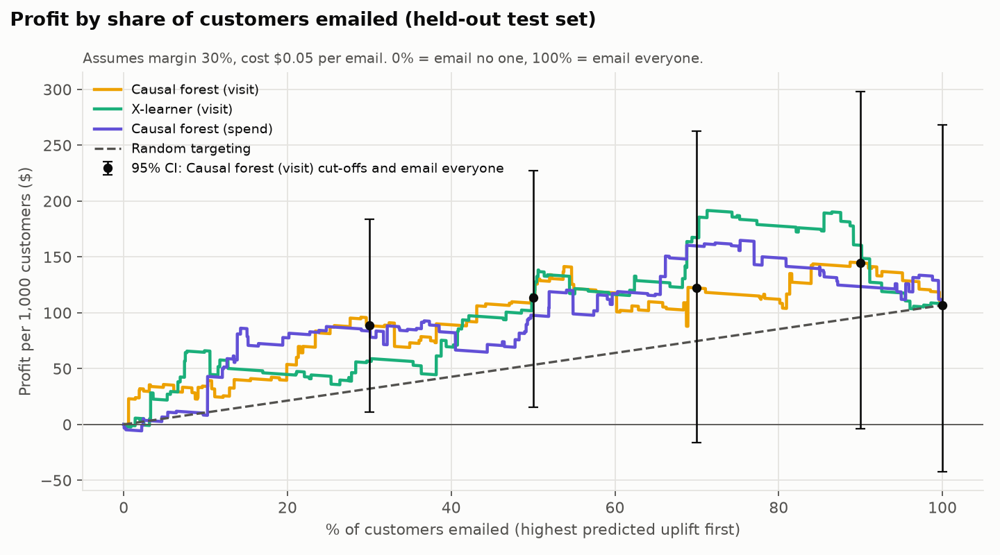

# Phase 3: The business decision (women's email vs. control)

Reproduce with `python -m src.phase3_policy` (after Phase 2). Numbers come
from `reports/tables/phase3_*.csv`, rounded here to the nearest dollar.
The valuation logic is explained in [`src/policy.py`](../src/policy.py).

**Question.** Should the retailer email everyone, no one, or a targeted
subset, and how much more profit does targeting make?

**Short answer.** On this test set, no targeted policy that emails 30%, 50%
or 70% of customers is distinguishable from emailing everyone. Emailing the
top 90% (dropping the 10% with the lowest predicted uplift) beats emailing
everyone by about $38 per 1,000 customers with an interval that excludes
zero, but that result rests on 8 buyers, does not survive a
multiple-comparison correction, and was found on a test set that was also
used to pick the model. It is a hypothesis for Phase 4, not a finding.

## 1. Setup

- **Data:** the Phase 2 held-out test set, 12,808 customers, 94 buyers.
  Models are not refit; the saved test-set scores are reused.
- **Policies:** email no one; email everyone; email the top 30 / 50 / 70 / 90%
  by predicted uplift; random targeting at the same shares.
- **Scores:** visit-trained causal forest (primary), visit-trained X-learner
  (sensitivity check), spend-trained causal forest (comparison).
- **Valuation uses actual outcomes only.** Each policy's incremental revenue
  is estimated by inverse propensity weighting with the known propensity
  (0.500937, the test-set treated share): the spend of emailed customers
  minus the spend of control customers, among those the policy targets. The
  model decides *who* is targeted; it never supplies the value. A
  difference-in-means cross-check inside each targeted group agrees to within
  $7 per 1,000 customers for every policy.
- **Profit** = margin × incremental revenue − cost per email × emails sent,
  per 1,000 customers. Base case: margin 30%, cost $0.05 (both assumptions,
  set in `src/config.py`).
- **Uncertainty:** 2,000 bootstrap resamples, each arm resampled separately.
  Every policy, and the random baseline (share × that resample's
  email-everyone value), is valued on the same resamples, so all differences
  are paired. Cut-offs are recomputed in each resample.

## 2. Incremental revenue, before margin and cost

Dollars of incremental revenue per 1,000 customers in the population.

| Policy | Emails per 1,000 | Incremental revenue | 95% CI | Lift per emailed customer |
|---|---|---|---|---|
| Email no one | 0 | $0 | – | – |
| Email everyone | 1,000 | $522 | [$26, $1,060] | $0.52 |
| Forest (visit): top 30% | 300 | $345 | [$87, $662] | $1.16 |
| Forest (visit): top 50% | 500 | $462 | [$134, $841] | $0.92 |
| Forest (visit): top 70% | 700 | $524 | [$62, $992] | $0.75 |
| Forest (visit): top 90% | 900 | $632 | [$138, $1,144] | $0.70 |
| X-learner (visit): top 30% | 300 | $239 | [−$46, $540] | $0.82 |
| X-learner (visit): top 50% | 500 | $471 | [$127, $847] | $0.94 |
| X-learner (visit): top 70% | 700 | $674 | [$268, $1,127] | $0.97 |
| X-learner (visit): top 90% | 900 | $685 | [$214, $1,177] | $0.76 |
| Forest (spend): top 30% | 300 | $329 | [$72, $613] | $1.07 |
| Forest (spend): top 50% | 500 | $409 | [$78, $753] | $0.82 |
| Forest (spend): top 70% | 700 | $649 | [$237, $1,105] | $0.93 |
| Forest (spend): top 90% | 900 | $561 | [$100, $1,057] | $0.62 |

The point estimates tell a consistent story: for the primary model, the top
30% of customers produce 66% of the incremental revenue ($345 of $522), and
lift per emailed customer falls steadily as the cut-off widens ($1.16 →
$0.52). But every interval is several hundred dollars wide, and they all
overlap.

Some targeted policies show *more* incremental revenue than emailing
everyone (e.g. $632 vs. $522). That is only possible if the excluded
customers had a negative measured lift. Section 5 looks at whether that is
believable.

## 3. Profit at the base case (margin 30%, $0.05 per email)

Dollars of profit per 1,000 customers. "vs. everyone" and "vs. random" are
paired differences; **bold** marks intervals that exclude zero.

| Policy | Profit | 95% CI | vs. email everyone | 95% CI | p | vs. random, same share | 95% CI | p |
|---|---|---|---|---|---|---|---|---|
| Email no one | $0 | – | −$107 | [−$268, $42] | 0.17 | – | – | – |
| Email everyone | $107 | [−$42, $268] | – | – | – | – | – | – |
| Forest (visit): top 30% | $88 | [$11, $184] | −$18 | [−$153, $107] | 0.78 | +$56 | [−$12, $134] | 0.11 |
| Forest (visit): top 50% | $114 | [$15, $227] | +$7 | [−$104, $120] | 0.86 | +$60 | [−$12, $144] | 0.10 |
| Forest (visit): top 70% | $122 | [−$16, $263] | +$15 | [−$56, $77] | 0.65 | +$47 | [−$17, $108] | 0.15 |
| Forest (visit): top 90% | $145 | [−$4, $298] | **+$38** | **[$8, $76]** | 0.008 | **+$49** | **[$17, $85]** | 0.002 |
| X-learner (visit): top 30% | $57 | [−$29, $147] | −$50 | [−$189, $75] | 0.43 | +$25 | [−$44, $100] | 0.44 |
| X-learner (visit): top 50% | $116 | [$13, $229] | +$9 | [−$100, $120] | 0.87 | +$63 | [−$14, $140] | 0.12 |
| X-learner (visit): top 70% | $167 | [$46, $303] | +$61 | [−$20, $149] | 0.13 | **+$93** | **[$24, $170]** | 0.010 |
| X-learner (visit): top 90% | $160 | [$19, $308] | **+$54** | **[$7, $110]** | 0.015 | **+$64** | **[$19, $117]** | < 0.001 |
| Forest (spend): top 30% | $84 | [$7, $169] | −$23 | [−$163, $105] | 0.67 | +$52 | [−$18, $121] | 0.16 |
| Forest (spend): top 50% | $98 | [−$2, $201] | −$9 | [−$129, $101] | 0.82 | +$44 | [−$34, $117] | 0.30 |
| Forest (spend): top 70% | $160 | [$36, $297] | +$53 | [−$25, $134] | 0.20 | **+$85** | **[$20, $155]** | 0.013 |
| Forest (spend): top 90% | $123 | [−$15, $272] | +$17 | [−$40, $73] | 0.59 | +$27 | [−$25, $81] | 0.31 |

Reading this honestly:

1. **Email everyone vs. email no one is not settled on this test set alone.**
   Email everyone earns $107 per 1,000, but the interval is [−$42, $268]
   (p = 0.17). The test set is a 30% sample; the full experiment answers
   this question better (section 4).
2. **Targeting 30%, 50% or 70% is not distinguishable from emailing
   everyone**, for any of the three score sets. Point estimates range from
   −$50 to +$61 per 1,000 and every interval comfortably includes zero.
3. **Top 90% is the one cut-off with an interval excluding zero**, for both
   visit-trained models (forest +$38, X-learner +$54), though not for the
   spend-trained forest (+$17, p = 0.59).
4. **Model targeting is usually ahead of random targeting at the same share
   in point estimate** (all twelve are positive, +$25 to +$93), and four of
   the twelve intervals exclude zero. For the primary model only the 90%
   cut-off does.

**Why the 90% result should not be taken at face value.**

- *Multiple comparisons.* Twelve model policies were compared with email
  everyone. The smallest p-value (0.008) becomes 0.096 after a Bonferroni
  correction for twelve tests. It does not survive.
- *Chosen on the test set.* The 90% cut-off stands out only after looking at
  four cut-offs on this test set, the same test set that was used to choose
  the model. A "best cut-off" picked this way has optimistic profit. If one
  cut-off has to be named, it is **top 90% with the visit-trained forest
  ($145 per 1,000)**, and that number needs confirming on fresh splits in
  Phase 4 before anyone relies on it.
- *It rests on 8 buyers* (section 5).
- *The test-set ATE is lucky.* The spend lift here is $0.52 per customer vs.
  $0.42 in the full sample, which inflates the profit of every policy that
  sends emails.

Why is the interval for the 90% comparison so much narrower than for 30%?
"Top 90%" and "everyone" treat 90% of customers identically, so their profits
differ only through the bottom 10%. The paired bootstrap cancels everything
else.

## 4. Sensitivity to margin and cost

**Primary model vs. email everyone**, paired difference in profit per 1,000
customers with 95% CI. Bold = interval excludes zero.

| Margin | Cost / email | Email everyone (profit) | Top 30% − everyone | Top 50% − everyone | Top 70% − everyone | Top 90% − everyone |
|---|---|---|---|---|---|---|
| 20% | $0.01 | $94 | −$29 [−$118, $55] | −$7 [−$81, $69] | +$3 [−$44, $44] | **+$23 [$3, $48]** |
| 20% | $0.05 | $54 | −$1 [−$90, $83] | +$13 [−$61, $89] | +$15 [−$32, $56] | **+$27 [$7, $52]** |
| 20% | $0.10 | $4 | +$34 [−$55, $118] | +$38 [−$36, $114] | +$30 [−$17, $71] | **+$32 [$12, $57]** |
| 30% | $0.01 | $147 | −$46 [−$181, $79] | −$13 [−$124, $100] | +$3 [−$68, $65] | **+$34 [$4, $72]** |
| 30% | $0.05 | $107 | −$18 [−$153, $107] | +$7 [−$104, $120] | +$15 [−$56, $77] | **+$38 [$8, $76]** |
| 30% | $0.10 | $57 | +$17 [−$118, $142] | +$32 [−$79, $145] | +$30 [−$41, $92] | **+$43 [$13, $81]** |
| 50% | $0.01 | $251 | −$82 [−$306, $128] | −$25 [−$209, $164] | +$4 [−$115, $106] | **+$56 [$5, $119]** |
| 50% | $0.05 | $211 | −$54 [−$278, $156] | −$5 [−$189, $184] | +$16 [−$103, $118] | **+$60 [$9, $123]** |
| 50% | $0.10 | $161 | −$19 [−$243, $191] | +$20 [−$164, $209] | +$31 [−$88, $133] | **+$65 [$14, $128]** |

- The pattern does not depend on the assumptions. In all nine cells the 30%,
  50% and 70% policies are indistinguishable from emailing everyone, and the
  90% policy has an interval excluding zero.
- The direction is what you would expect: narrow targeting looks relatively
  better when emails are expensive and margins thin (top row vs. third row),
  and worse when emails are nearly free.
- Across all three score sets and all nine cells (108 comparisons), a
  targeted policy beats email everyone with an interval excluding zero in 20:
  forest-visit top 90% (9 of 9 cells), X-learner top 90% (9 of 9), X-learner
  top 70% (1) and spend-forest top 70% (1). None is significantly *worse*
  than emailing everyone.

**Email everyone vs. email no one, using the full experiment.** This
comparison needs no model, so it can use all 42,693 customers instead of the
test set. From the Phase 1 ATE (+$424 per 1,000, 95% CI [$169, $680]):

| Margin | Cost $0.01 | Cost $0.05 | Cost $0.10 |
|---|---|---|---|
| 20% | **$75 [$24, $126]** | $35 [−$16, $86] | −$15 [−$66, $36] |
| 30% | **$117 [$41, $194]** | **$77 [$1, $154]** | $27 [−$49, $104] |
| 50% | **$202 [$74, $330]** | **$162 [$34, $290]** | $112 [−$16, $240] |

Profit of emailing everyone, per 1,000 customers. Emailing everyone is
clearly profitable when emails cost a cent, borderline at the base case
($77, interval just above zero), and unproven at $0.10 per email. The
break-even cost per email is margin × $0.42: about $0.13 at a 30% margin,
but as low as $0.05 at the bottom of the confidence interval.

## 5. What is behind the top-90% result

The customers the visit-trained forest ranks in its bottom 10% (1,281
people):

| Arm | Customers | Visitors | Buyers | Total spend | Largest purchase |
|---|---|---|---|---|---|
| Women's email | 640 | 79 | 2 | $123 | $88 |
| Control | 641 | 56 | 6 | $825 | $248 |

- **Who they are:** every one of them bought only men's merchandise in the
  past year (`mens = 1`, `womens = 0`). It is plausible that a women's
  merchandise email does nothing for them.
- **What the data shows:** the emailed half visited *more* (79 vs. 56) but
  bought *less* (2 buyers vs. 6). Taken literally, the email cost about $1.10
  of revenue per customer in this group.
- **How much weight it bears:** the entire result is 2 buyers against 6. Move
  two or three purchases and it disappears. "The email does nothing for
  men's-only buyers, so save the cost" is credible. "The email actively
  loses sales among them" is a much stronger claim that 8 buyers cannot
  support.
- Under a "does nothing" reading, dropping the bottom 10% saves only the
  email cost: 100 emails × $0.05 = $5 per 1,000 customers at the base case,
  not $38.

## 6. Who are the persuadables?

Top 30% vs. bottom 30% of test customers by the forest's predicted visit
uplift (3,842 customers each). This describes what the model's high-score
customers look like. These are predicted differences, not proof that the
traits cause a bigger response.

| Covariate | Top 30% | Bottom 30% | All test customers |
|---|---|---|---|
| Bought women's merchandise last year | 100% | 0% | 55% |
| Bought men's merchandise last year | 19% | 100% | 55% |
| Past-year spend (`history`) | $318 | $204 | $243 |
| New customer (`newbie`) | 60% | 47% | 50% |
| Recency (months) | 5.8 | 5.8 | 5.8 |
| Zip: Rural | 9% | 16% | 15% |
| Zip: Suburban | 48% | 45% | 45% |
| Zip: Urban | 44% | 39% | 40% |
| Channel: Multichannel | 19% | 12% | 12% |
| Channel: Phone | 37% | 45% | 44% |
| Channel: Web | 45% | 43% | 44% |

- **The dominant pattern is product affinity.** Every customer in the top
  group bought women's merchandise last year, and every customer in the
  bottom group bought only men's. The model's main finding is the
  unsurprising one: the women's email works on people who buy women's
  products.
- **Secondary traits** of the top group: higher past spend, more often new
  customers, more often multichannel, less often rural or phone-only.
  Recency does not differ.
- The X-learner gives the same picture (top 30%: 100% women's buyers, 21%
  men's buyers, $330 past spend, 66% new customers; bottom 30%: 100% men's
  buyers), so the description is not specific to one model.

**Did the groups actually respond differently?** Emailed minus control within
each group, from the experiment:

| Group | Predicted visit uplift | Actual visit lift | Actual conversion lift | Actual spend lift |
|---|---|---|---|---|
| Top 30% | +8.1 pp | +6.3 pp [4.1, 8.6] | +0.73 pp [0.12, 1.34] | +$1.16 [$0.22, $2.09] |
| Middle 40% | +4.7 pp | +4.5 pp [2.6, 6.4] | +0.39 pp [−0.07, 0.84] | +$0.45 [−$0.47, $1.36] |
| Bottom 30% | +0.7 pp | +2.8 pp [0.9, 4.8] | −0.21 pp [−0.69, 0.27] | −$0.01 [−$0.77, $0.76] |
| Top − bottom | | +3.5 pp [0.5, 6.5], p = 0.022 | +0.94 pp [0.17, 1.72], p = 0.017 | +$1.16 [−$0.05, $2.38], p = 0.060 |

- The ordering holds for all three outcomes: top > middle > bottom.
- The top-vs-bottom gap is significant for visit and conversion and just
  short of it for spend.
- The model over-separates: it predicts a 7.4 pp gap in visit lift between
  top and bottom, and the actual gap is 3.5 pp. The bottom group still
  responds with visits (+2.8 pp), but there is no sign those visits turn into
  purchases.
- The spend lift is only individually significant in the top 30%.

## 7. Answer to the business question

- **Email everyone vs. no one:** emailing everyone is the better default at
  low email cost. At the base case it earns about $77 per 1,000 customers on
  the full experiment, with an interval that only just clears zero. At $0.10
  per email it is not established.
- **Targeted vs. everyone:** not established. No policy that emails 30–70%
  of customers differs detectably from emailing everyone. Excluding the
  bottom 10% looks better by about $38 per 1,000 at the base case, but for
  the reasons in section 3 this is a lead to test, not a result to bank.
- **Model vs. random targeting:** if the retailer must email fewer people
  (budget, fatigue, deliverability), choosing them with the model looks
  better than choosing at random at every share tested (+$47 to +$60 per
  1,000 for the primary model), but only the 90% cut-off has an interval
  excluding zero.
- **Who to prioritise:** past buyers of women's merchandise, especially
  higher-spending, newer, multichannel customers. Men's-only buyers visit
  after the women's email but show no purchase response.
- **Size of the prize, in perspective:** the best-supported gain from
  targeting is on the order of tens of dollars per 1,000 customers. On a
  list of 64,000 that is a few thousand dollars per campaign at most, before
  discounting for optimism.

## 8. Caveats carried into Phase 4

1. One train/test split; the test set chose both the model and (if used) the
   cut-off, and has a lucky spend ATE. Repeated splits are needed.
2. Intervals reflect test-set sampling only, not retraining variability.
3. 94 buyers in the test set; every revenue number moves with a handful of
   purchases.
4. Margin and cost are assumptions. A flat margin ignores returns, and a
   flat cost ignores unsubscribes and email fatigue, which would favour
   sending fewer emails.
5. Outcomes cover two weeks. Longer-run effects (pulled-forward purchases,
   list fatigue) are not observed.
