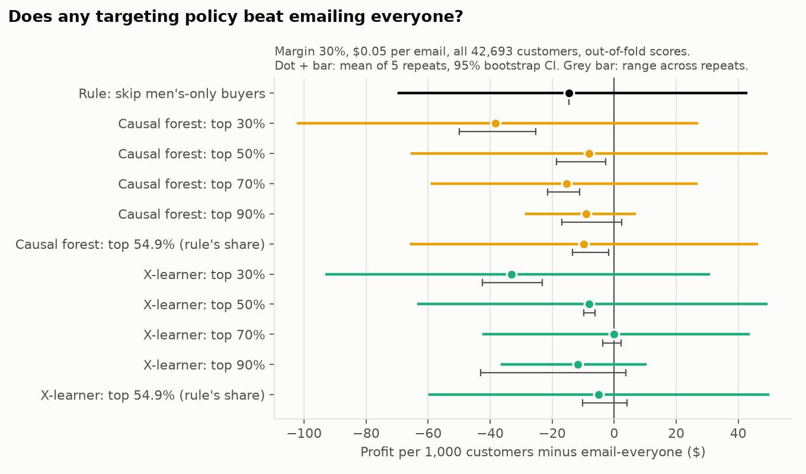
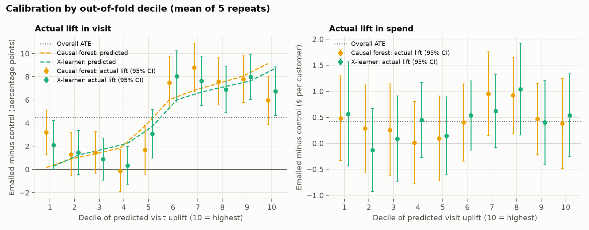
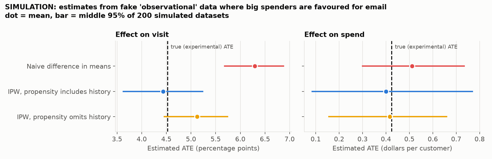

# Phase 4: Robustness, and "is this actually causal?"

Reproduce with:

```
python -m src.phase4_crossfit      # slow (about 6 minutes); caches out-of-fold scores
python -m src.phase4_robustness    # policy re-test, calibration, stability
python -m src.phase4_simulation    # confounding demonstration
```

Numbers come from `reports/tables/phase4_*.csv`.

## Summary

Phases 2–3 leaned on one 30% test set. Re-testing on all 42,693 customers
with cross-fitted scores gives a cleaner and less flattering picture:

- **The top-90% result did not replicate.** Dropping the bottom 10% by
  predicted uplift is −$9 per 1,000 customers relative to emailing everyone
  (95% CI [−$28, +$7]), not +$38.
- **No targeting policy beats emailing everyone.** Every point estimate is
  zero or negative; every interval includes zero.
- **The models are mostly rediscovering one rule.** At the same email volume,
  99.4% of the customers the forest leaves out are men's-only buyers. The
  model's edge over the plain rule "skip men's-only buyers" is $5–$9 per
  1,000 customers.
- **What does hold up:** the models rank *visit* uplift far better than
  random, and the heterogeneity is real. It is almost entirely one variable:
  whether the customer bought women's merchandise last year.
- **For spend, heterogeneity is not established.** Even the men's-only vs.
  everyone-else difference in spend lift is not significant (p = 0.32).

## 1. Re-testing the Phase 3 findings with cross-fitting

### Design (fixed before looking at results)

- **Scores.** 5 repeats × 5 folds on all 42,693 women's-email and control
  customers (311 buyers). In each fold a visit-trained causal forest and a
  visit-trained X-learner are fit on the other four folds, with the Phase 2
  hyperparameters and the known propensity, and score the held-out fold.
  Every customer gets five out-of-fold scores per model, each from a model
  that never saw them. Nothing was tuned.
- **Policies.** Email no one; email everyone; model top 30 / 50 / 70 / 90%;
  and a no-ML rule: *email everyone except customers who bought only men's
  merchandise last year*. That rule emails 54.9% of customers, so each model
  is also run at exactly 54.9% for a like-for-like comparison.
- **"Top X%" is ranked within each fold**, because each fold's scores come
  from a different fitted model.
- **Valuation.** IPW on actual spend with the known propensity, at the base
  case (margin 30%, $0.05 per email), per 1,000 customers.
- **Uncertainty, two kinds.** (1) *Range across repeats:* how much the
  answer moves when only the fold assignment changes. (2) *Bootstrap 95% CI*
  for the mean of the five repeats: 2,000 resamples of customers with their
  out-of-fold targeting decisions held fixed, all policies valued on the
  same resamples. Unlike Phase 3, cut-offs are not recomputed inside each
  resample. The bootstrap does not include retraining noise; the range
  across repeats shows that separately.

### Results

Profit per 1,000 customers, mean of five repeats.

| Policy | Emailed | Profit | 95% CI | vs. email everyone | Range across repeats | 95% CI | p |
|---|---|---|---|---|---|---|---|
| Email no one | 0% | $0 | – | −$77 | – | [−$156, $4] | 0.06 |
| Email everyone | 100% | $77 | [−$4, $156] | – | – | – | – |
| Rule: skip men's-only | 54.9% | $63 | [$9, $120] | −$14 | (no model) | [−$70, $42] | 0.59 |
| Forest: top 30% | 30% | $39 | [$3, $76] | −$38 | −$50 to −$25 | [−$102, $27] | 0.27 |
| Forest: top 50% | 50% | $69 | [$18, $123] | −$8 | −$19 to −$3 | [−$65, $49] | 0.77 |
| Forest: top 70% | 70% | $62 | [$0, $123] | −$15 | −$21 to −$11 | [−$59, $26] | 0.44 |
| Forest: top 90% | 90% | $68 | [−$7, $140] | −$9 | −$17 to +$2 | [−$28, $7] | 0.30 |
| Forest: top 54.9% | 54.9% | $68 | [$14, $124] | −$10 | −$13 to −$2 | [−$65, $46] | 0.70 |
| X-learner: top 30% | 30% | $44 | [$5, $86] | −$33 | −$42 to −$23 | [−$93, $31] | 0.31 |
| X-learner: top 50% | 50% | $69 | [$18, $124] | −$8 | −$10 to −$6 | [−$63, $49] | 0.77 |
| X-learner: top 70% | 70% | $77 | [$19, $137] | $0 | −$4 to +$2 | [−$42, $43] | 1.00 |
| X-learner: top 90% | 90% | $66 | [−$6, $135] | −$12 | −$43 to +$4 | [−$36, $10] | 0.33 |
| X-learner: top 54.9% | 54.9% | $72 | [$19, $129] | −$5 | −$10 to +$4 | [−$60, $50] | 0.85 |



### (a) Does top 90% still beat email everyone?

**No.** Phase 3 had it at +$38 per 1,000 (CI [$8, $76]) for the forest and
+$54 for the X-learner. On the full sample it is −$9 [−$28, +$7] and −$12
[−$36, +$10]. The sign flipped and the interval includes zero. The difference is
negative in four of the five forest repeats (+$2, −$6, −$12, −$17, −$13) and
three of the five X-learner repeats (−$5, +$1, −$43, +$4, −$16).

The reason is visible in the lowest-predicted decile. Phase 3's bottom 10%
had 2 emailed buyers against 6 control buyers. On the full sample the
forest's bottom decile averages 13.2 emailed buyers against 10.0 control, and
its spend lift is +$0.48 per customer (standard error $0.41), not −$1.10.
The Phase 3 result was a handful of purchases landing on one side of one
split, as that report warned it might be.

### (b) Does the model beat the simple men's-only rule?

**Barely, and it is mostly the same policy.**

| Policy (at the rule's 54.9% share) | Profit minus rule | Range across repeats | 95% CI | p | Excluded customers who are men's-only |
|---|---|---|---|---|---|
| Causal forest | +$5 | +$1 to +$13 | [−$1, $12] | 0.11 | 99.4% |
| X-learner | +$9 | +$4 to +$19 | [$2, $18] | 0.003 | 97.7% |

- When given the same number of emails as the rule, 99.4% of the customers
  the forest leaves out are men's-only buyers (97.7% for the X-learner). The
  models are rediscovering the rule, not finding something different.
- The same shows at every cut-off. Excluded customers who are men's-only:
  100% at top 90%, 99.99% at top 70%, 90% at top 50% (the forest). The
  model's ranking is "men's-only buyers last, everyone else first".
- The X-learner's +$9 has an interval excluding zero. It is narrow because
  the two policies differ on only about 2% of customers, so it rests on very
  few purchases, and $9 per 1,000 customers is about $600 on a 64,000-customer
  list. I would not build and maintain a model for that.
- Neither the rule nor any model policy beats emailing everyone. The rule is
  −$14 [−$70, $42].

**Why excluding men's-only buyers does not pay at the base case.** Lift by
last year's purchase category, full sample, no model:

| Group | Customers | Buyers (emailed / control) | Visit lift | Conversion lift | Spend lift |
|---|---|---|---|---|---|
| Men's only | 19,260 | 59 / 53 | +1.1 pp [0.2, 2.0] | +0.06 pp [−0.15, 0.28] | +$0.28 [−$0.12, $0.68] |
| Women's only | 19,166 | 99 / 49 | +7.4 pp [6.4, 8.4] | +0.51 pp [0.26, 0.76] | +$0.63 [$0.30, $0.97] |
| Both | 4,267 | 31 / 20 | +7.1 pp [4.7, 9.6] | +0.53 pp [−0.12, 1.19] | +$0.16 [−$0.81, $1.14] |
| Women's only or both | 23,433 | 130 / 69 | +7.3 pp [6.4, 8.2] | +0.51 pp [0.28, 0.75] | +$0.54 [$0.22, $0.87] |
| Difference (women's or both − men's only) | | | +6.2 pp [5.0, 7.5], p < 0.001 | +0.45 pp [0.13, 0.77], p = 0.006 | +$0.27 [−$0.25, $0.78], p = 0.32 |

- For **visits and conversions** the gap is unmistakable: the women's email
  moves women's-merchandise buyers roughly six to seven times as much as
  men's-only buyers on visits (+7.3 pp vs. +1.1 pp).
- For **spend** the gap is *not* significant (p = 0.32). The men's-only
  spend lift has a positive point estimate (+$0.28) with an interval
  spanning zero. At a 30% margin that is $0.084 of margin per email against
  a $0.05 cost, so the point estimate says emailing them is marginally
  profitable, and the data cannot tell that apart from zero or from a loss.
  The break-even cost per email for this group is about $0.08 at the point
  estimate. At $0.10 per email the rule would look better than emailing
  everyone in point estimate, still without statistical support.
- There is no evidence of a *negative* effect in this group.

### (c) Which earlier findings replicate?

| # | Earlier finding | Phase 4 result | Verdict |
|---|---|---|---|
| P1 | Randomization holds; both emails raise visit, conversion and spend on average | Full-sample results, not split-dependent | Unchanged |
| P2-a | All models rank visit uplift better than random | AUUC vs. random: forest +0.0068 [0.0051, 0.0085], X-learner +0.0073 [0.0056, 0.0090], both p < 0.001; about 30% more area than random | **Replicated** (stronger) |
| P2-b | Forest and X-learner are statistically tied | AUUC difference −0.0005 [−0.0011, 0.0002], p = 0.16 | **Replicated** |
| P2-c | Visit-trained models also rank incremental *revenue* better than random (two of four at p ≈ 0.04) | Forest +0.034 [−0.040, 0.106], p = 0.34; X-learner +0.044 [−0.031, 0.119], p = 0.23 | **Did not replicate** |
| P3-1 | Top 90% beats email everyone by $38 per 1,000 | −$9 [−$28, $7] | **Did not replicate** |
| P3-2 | Top 30/50/70% indistinguishable from email everyone | All intervals include zero; point estimates now −$38 to $0 | **Replicated** |
| P3-3 | Bottom 10% (men's-only) has a negative spend lift | Bottom decile +$0.48 (SE $0.41); men's-only group +$0.28 [−$0.12, $0.68] | **Did not replicate** |
| P3-4 | Model beats random targeting at every share (point estimate) | Positive at 30/50/70% (+$8 to +$31), about zero at 90% (−$1, −$4); no interval excludes zero | **Weakened** |
| P3-5 | Persuadables are defined by product affinity (women's-merchandise buyers) | Deciles 1–4 are 99.9–100% men's-only, deciles 6–10 are 0% (forest) | **Replicated** |
| P3-6 | Top 30% has a significant spend lift ($1.16) and top-minus-bottom is nearly significant | Top three deciles average about +$0.59; no decile ordering in spend | **Weakened** |
| P3-7 | Email everyone beats email no one at the base case ($77 per 1,000) | $77; bootstrap CI [−$4, $156], p = 0.06 (the analytic CI in Phase 3 was [$1, $154]) | Unchanged: **borderline** |

The pattern: results about **visits** and about **who** responds replicate.
Results about **dollars from targeting** do not. The model-selection and
lucky-split optimism flagged in Phases 2 and 3 was real and was large enough
to create the headline Phase 3 result.

## 2. Calibration

Customers grouped into deciles of out-of-fold predicted visit uplift
(decile 10 = highest), then emailed vs. control compared inside each decile.
Mean of five repeats; intervals use the single-repeat standard error, which
errs on the wide side.



Causal forest:

| Decile | Predicted visit uplift | Actual visit lift | Actual spend lift | Men's-only |
|---|---|---|---|---|
| 1 (lowest) | +0.2 pp | +3.2 pp (± 1.9) | +$0.48 (± $0.81) | 100% |
| 2 | +0.9 pp | +1.3 pp (± 1.9) | +$0.28 (± $0.84) | 100% |
| 3 | +1.4 pp | +1.5 pp (± 1.8) | +$0.25 (± $0.88) | 100% |
| 4 | +1.9 pp | −0.1 pp (± 1.8) | +$0.01 (± $0.79) | 99.9% |
| 5 | +3.7 pp | +1.7 pp (± 2.1) | +$0.09 (± $0.81) | 51% |
| 6 | +6.0 pp | +7.5 pp (± 2.2) | +$0.40 (± $0.74) | 0% |
| 7 | +6.8 pp | +8.8 pp (± 2.1) | +$0.95 (± $0.81) | 0% |
| 8 | +7.4 pp | +7.6 pp (± 2.0) | +$0.92 (± $0.74) | 0% |
| 9 | +8.1 pp | +7.8 pp (± 2.0) | +$0.46 (± $0.69) | 0% |
| 10 (highest) | +9.1 pp | +6.0 pp (± 2.1) | +$0.38 (± $0.86) | 0% |

(± is 1.96 × standard error.)

- **Visit: the predicted order holds between the two halves, not within
  them.** Deciles 6–10 have actual lifts of 6.0–8.8 pp; deciles 1–5 have
  −0.1 to 3.2 pp. That step is real and large.
- **Within each half the ranking carries no visible signal.** Among
  women's-merchandise buyers (deciles 6–10) predicted uplift rises from 6.0
  to 9.1 pp while actual lift goes 7.5, 8.8, 7.6, 7.8, 6.0: the top decile
  is the lowest of the five. Among men's-only buyers (deciles 1–4) predicted
  rises from 0.2 to 1.9 pp while actual goes 3.2, 1.3, 1.5, −0.1.
- **So the model is roughly calibrated on average but over-separates.** The
  calibration slope (actual on predicted, by decile) is 0.83 for the forest
  (0.79–0.89 across repeats) and 0.95 for the X-learner (0.82–1.05). The
  extremes are overstated: the lowest decile is predicted +0.2 pp and
  delivers +3.2 pp; the highest is predicted +9.1 pp and delivers +6.0 pp.
- **Spend: no decile ordering can be established.** Every decile's interval
  includes the overall ATE of $0.42, and all but two include zero. The point
  estimates are somewhat higher in deciles 6–8, but the lowest decile
  (+$0.48) is above the highest (+$0.38).

Plain reading: the visit effect has essentially **two levels**, set by one
binary variable. Everything else the models do with recency, history,
channel and so on does not show up as better ranking.

## 3. Stability

How much do scores move when the model is retrained on a different 80% of
the data?

| Comparison | Spearman rank correlation (mean, range) |
|---|---|
| Causal forest: same customer, different repeats | 0.91 (0.90–0.92) |
| X-learner: same customer, different repeats | 0.86 (0.85–0.87) |
| Forest vs. X-learner, same repeat | 0.90 (0.89–0.91) |

How often is a customer in the top 30% across the five repeats?

| Model | Never | 1–4 times | All 5 times | Top-30% in one repeat → also top-30% in another |
|---|---|---|---|---|
| Causal forest | 58.3% | 24.5% | 17.2% | 79.8% |
| X-learner | 54.6% | 32.3% | 13.1% | 73.5% |

- Overall rankings are stable (0.86–0.91), and the forest is the more stable
  of the two, which supports the Phase 2 reason for choosing it.
- That stability mostly reflects the big men's-only vs. not split, which
  every fit finds. **Membership of the top 30% is much less stable:** a
  customer in the forest's top 30% in one repeat has a 20% chance of not
  being there in another, and only 17% of customers are in it every time
  (against 30% if it were perfectly stable). Of customers who ever make the
  top 30%, 41% make it every time (29% for the X-learner).
- This fits the calibration result. The top 30% is carved out of the
  women's-merchandise buyers, where scores are nearly flat and the ordering
  is mostly noise.
- Any two of these fits share about 80% of their training customers, so
  this is a lower bound on how much rankings would move with a genuinely new
  sample.

## 4. Why these estimates are causal, and what would break them

### Why randomization is enough

The question "what did the email do?" compares each customer's outcome with
the email to their outcome without it. Only one of those is ever observed.
So we compare *groups*, and that only works if the emailed and non-emailed
groups would have behaved the same had neither been emailed.

Random assignment guarantees that. A coin flip cannot know a customer's
spending history, loyalty, mood or anything else, so on average the two
groups match on every characteristic: the ones in the data (Phase 1 checked
these) and, crucially, the ones nobody recorded. The only systematic
difference left between the groups is the email, so a difference in outcomes
is the email's effect.

Three things follow, and this project relies on each:

1. **The simple difference in means is an unbiased estimate of the ATE**
   (Phase 1). No adjustment is needed for validity.
2. **The same holds inside any subgroup defined by pre-treatment
   information**, including "the customers a model ranks in its top 30%".
   That is what makes Qini curves, policy values and calibration tables
   legitimate: each is an emailed-vs-control comparison inside a group
   chosen without reference to who was emailed.
3. **The propensity is known, not estimated** (about 0.5 for everyone),
   which is why the X-learner, the causal forest and the IPW valuations
   could plug in a constant.

What randomization does *not* give us: the effect for a named individual;
any guarantee that a model's predicted uplift is right (only held-out data
tests that); or validity beyond this population, this email and this
two-week window.

### What would break with observational data: a simulation

**Everything in this subsection is a simulation.** The "observational" data
is manufactured from the real experiment to demonstrate a mechanism. It is
not a finding about the retailer.

*Setup.* Pretend marketers, not a coin, chose who to email, and that they
favoured big spenders. To fake this, rows are discarded: an emailed customer
is kept with probability p, a control customer with probability 1 − p, where
p rises with past-year spend and is clipped to the range 0.2–0.8. In the
resulting dataset (about 21,400 customers) the emailed group's average
past-year spend is $327 against $157 for the control group. Because the
original arms are 50/50, every customer has the same 50% chance of
surviving, so the mix of customers is unchanged and the true ATE is still
the experimental one. Any gap is caused purely by how treatment was
assigned. The exercise is repeated 200 times.

*Three estimators on each fake dataset.*

1. **Naive:** difference in means, as if it were an experiment.
2. **IPW with history:** estimate each customer's probability of being
   emailed with a logistic regression on all covariates, then weight each
   customer by one over the probability of the arm they were in.
3. **IPW without history:** the same, but the propensity model is not given
   `history` (or its binned copy). This stands in for an **unmeasured
   confounder**: the analyst does everything correctly but lacks the one
   variable that drove assignment.



| Outcome | Estimator | True ATE | Mean estimate | Bias | Middle 95% of 200 runs | Runs above the truth |
|---|---|---|---|---|---|---|
| Visit | Naive | 4.52 pp | 6.29 pp | +39% | [5.68, 6.88] | 100% |
| Visit | IPW with history | 4.52 pp | 4.43 pp | −2% | [3.63, 5.23] | 39% |
| Visit | IPW without history | 4.52 pp | 5.12 pp | +13% | [4.46, 5.74] | 95% |
| Spend | Naive | $0.424 | $0.512 | +21% | [$0.300, $0.734] | 76% |
| Spend | IPW with history | $0.424 | $0.400 | −6% | [$0.085, $0.769] | 42% |
| Spend | IPW without history | $0.424 | $0.416 | −2% | [$0.157, $0.659] | 49% |

*What it shows.*

- **Naive is badly wrong on visits:** 39% too high, and above the truth in
  every one of 200 runs. The emailed group is richer, richer customers visit
  more anyway, and the naive comparison credits that to the email.
- **IPW with the confounder measured fixes it:** within 2% of the truth.
- **IPW without the confounder does not:** still 13% too high and above the
  truth in 95% of runs. It removes about two thirds of the bias, because
  other covariates (buying from both categories, multichannel, newbie) are
  correlated with spending history and act as partial proxies, but not all
  of it.
- **On spend the demonstration is inconclusive, and I am not going to
  pretend otherwise.** The naive estimate is 21% high on average but
  individual runs scatter so widely that it is above the truth only 76% of
  the time. The no-history IPW averages within 2% of the truth, so on this
  outcome it does *not* visibly fail. Spend is too noisy, and history too
  weakly related to two-week spend once the other covariates are in, for the
  bias to show. The IPW-with-history estimate is 6% low on average, which is
  about two standard errors of the simulation mean; the fitted propensities
  range more widely (0.18–0.94) than the true ones (0.2–0.8) because a
  logistic curve cannot reproduce the clipping, so some mis-specification is
  present.

*The lesson.* **Adjustment only fixes the confounders you measured.** IPW,
matching, regression and causal forests with an estimated propensity all
work by comparing like with like on recorded variables. If assignment
depended on something unrecorded (a marketer's judgement, a loyalty flag
that never reached the warehouse), the estimate stays biased, nothing in the
data flags it, and the confidence interval is just as narrow. In real
observational data you cannot check, because the truth is unknown. Here it
is known only because the experiment exists.

Had this project used observational data, everything downstream would
inherit that problem: CATE models would learn "who gets emailed" mixed with
"who responds", and policy values would no longer be valid, since they rely
on emailed and control customers inside a targeted group being comparable.

## 5. Limitations

**Small effects, noisy money.**

- The whole spend analysis rests on 311 buyers out of 42,693 customers (578
  across all three arms). A decile of the data contains about 30 buyers.
- The average spend lift, +$0.42 per customer, has a 95% CI of [$0.17,
  $0.68]. Differences *between groups* in spend lift are smaller than the
  noise: the largest pre-specified contrast (women's-or-both vs. men's-only)
  is +$0.27 with p = 0.32.
- A rough power check: that contrast has a standard error of $0.26. To
  detect a true difference of $0.27 with 80% power at the 5% level the
  standard error would need to be about $0.095, which takes roughly eight
  times this sample.
- Consequence: this dataset can establish that the email works and who
  *visits* because of it. It cannot establish who *spends more* because of
  it.

**Evaluation.**

- Phase 3's headline result came from one test set that was also used to
  choose the model and the cut-off. Phase 4 shows it was noise. The
  Phase 4 numbers are the ones to quote.
- Bootstrap intervals in this phase hold the fitted scores fixed. Retraining
  variability is shown only as a range over five repeats that share most of
  their training data.
- Many comparisons were made across four phases. Isolated p-values near 0.05
  (several appeared and then vanished) should be read with that in mind.
- Hyperparameters were fixed, not tuned. Tuned models might rank slightly
  better. Given the calibration result (two levels, flat within), a large
  improvement seems unlikely, but it was not tested.

**Assumptions not in the data.**

- Margin (30%) and cost per email ($0.05) are placeholders. The email-
  everyone decision is sensitive to them: it is clearly profitable at $0.01
  per email and unproven at $0.10.
- A flat margin ignores returns and product mix. A flat per-email cost
  ignores unsubscribes, spam complaints and list fatigue, all of which make
  the marginal email more expensive than the invoice suggests and would
  favour sending fewer.

**Scope.**

- **Two-week window.** Purchases pulled forward from week three look like
  incremental revenue here. Unsubscribes and fatigue from an irrelevant
  email (for example the women's email to men's-only buyers, who do visit
  but do not buy) are invisible.
- **One campaign.** These are effects of one creative sent once. Effects of
  a programme of repeated sends may differ, and interference between
  customers (forwarding, households) is assumed away.
- **2008 data.** Email volume, inbox filtering, mobile reading and
  e-commerce conversion rates have all changed. The *method* transfers; the
  effect sizes should not be assumed to.
- **Population.** Everyone here bought in the previous twelve months. Nothing
  can be said about lapsed customers or prospects.
- **Eight coarse covariates.** There is no browsing behaviour, email
  engagement history or product-level purchase data. Richer features are
  where real within-group heterogeneity would be found, if it exists.
- **Women's email only.** The men's email and the three-arm policy (which
  email, if any, for each customer) have not been analysed. Given that
  product affinity drives the women's-email response, matching email to
  purchase history is the obvious hypothesis, and it is untested here.
