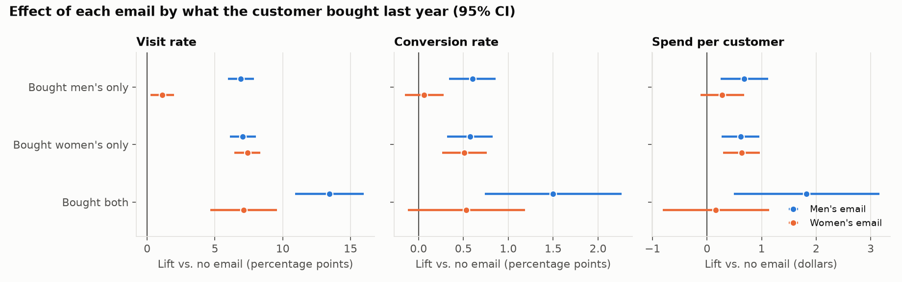

# Phase 4b: The three-arm decision (which email, if any, for each customer)

Reproduce with `python -m src.phase4b_three_arm`. Numbers come from
`reports/tables/phase4b_*.csv`.

**Question.** Phase 4 found the women's email barely moves men's-only buyers.
Should they get the men's email instead? The experiment already has a
men's-email arm, so this needs no new data and no model.

**Short answer.** The expected "match the email to the customer" story is
only half right. The women's email does depend on what the customer bought.
The men's email does not: it works about equally well on women's-only buyers
as on men's-only buyers. As a result, **sending the men's email to everyone
has the highest estimated profit of the pre-specified policies**, about $104
per 1,000 customers more than sending the women's email to everyone (95% CI
[$8, $198], p = 0.031). The matched rule sits in between and is not
significantly different from either. The spend evidence is suggestive, not
conclusive; the visit and conversion evidence is strong.

## 1. Design

- **Data:** all 64,000 customers, three arms (about one third each).
- **Segments, fixed in advance:** bought men's only (28,818), women's only
  (28,734), both (6,448). Every customer falls in exactly one.
- **Within-segment effects:** difference in means, valid because assignment
  was random inside every segment.
- **Policies:** each assigns every segment one of {no email, men's email,
  women's email}. Valued with three-arm IPW on actual spend, using the known
  arm shares as propensities.
- **Profit** = margin × incremental revenue − cost per email × emails sent,
  per 1,000 customers. Base case 30% and $0.05, plus the 3 × 3 grid.
- **Uncertainty:** 2,000 bootstrap resamples (each arm resampled
  separately), all policies valued on the same resamples.
- **No model, no train/test split.** The segments and the first four
  policies were fixed before looking at results, so there is no selection
  optimism in them. The fifth policy (best email per segment) is chosen from
  this data and *is* optimistic.

## 2. Effect of each email within each segment

**Each email vs. no email** (95% CI). Bold = survives a Bonferroni
correction across all 27 within-segment tests.

| Segment | Email | Visit lift | Conversion lift | Spend lift |
|---|---|---|---|---|
| Men's only | Men's | **+6.9 pp [6.0, 7.9]** | **+0.60 pp [0.34, 0.86]** | +$0.68 [$0.25, $1.12] |
| Men's only | Women's | +1.1 pp [0.2, 2.0] | +0.06 pp [−0.15, 0.28] | +$0.28 [−$0.12, $0.68] |
| Women's only | Men's | **+7.1 pp [6.1, 8.0]** | **+0.57 pp [0.32, 0.82]** | **+$0.62 [$0.27, $0.96]** |
| Women's only | Women's | **+7.4 pp [6.4, 8.4]** | **+0.51 pp [0.26, 0.76]** | **+$0.63 [$0.30, $0.97]** |
| Both | Men's | **+13.4 pp [10.9, 16.0]** | **+1.50 pp [0.74, 2.26]** | +$1.83 [$0.49, $3.16] |
| Both | Women's | **+7.1 pp [4.7, 9.6]** | +0.53 pp [−0.12, 1.19] | +$0.16 [−$0.81, $1.14] |

**Men's email minus women's email**, within segment:

| Segment | Visit | Conversion | Spend |
|---|---|---|---|
| Men's only | **+5.8 pp [4.8, 6.8]** | **+0.54 pp [0.27, 0.80]** | +$0.40 [−$0.07, $0.88], p = 0.096 |
| Women's only | −0.3 pp [−1.4, 0.7] | +0.06 pp [−0.23, 0.35] | −$0.02 [−$0.42, $0.39], p = 0.94 |
| Both | **+6.3 pp [3.7, 9.0]** | +0.97 pp [0.14, 1.79] | +$1.66 [$0.33, $2.99], p = 0.014 |

What this shows:

- **The men's email works in every segment**, and by about the same amount
  for men's-only and women's-only buyers (+6.9 vs. +7.1 pp on visits). A
  direct test of whether its effect differs between those two segments finds
  nothing: p = 0.84 for visit, 0.88 for conversion, 0.81 for spend.
- **The women's email is the one that depends on the customer.** It lifts
  visits by 7.4 pp for women's-only buyers and 1.1 pp for men's-only buyers
  (difference p < 0.001), as Phase 4 found.
- **For women's-only buyers the two emails are indistinguishable** on all
  three outcomes.
- **For men's-only buyers and for buyers of both, the men's email is clearly
  better on visits.** On conversion it is clearly better for men's-only
  buyers.
- **On spend, no men's-vs-women's difference survives correction.** The
  "both" segment looks striking (+$1.66) but it is the smallest segment
  (104 buyers across three arms), its unadjusted p-value is 0.014, and the
  Bonferroni-adjusted value is 0.39.

Multiple comparisons: 27 within-segment tests were run. Bold cells are the
ones with adjusted p < 0.05. All of the surviving results are for visits or
conversions except the two spend effects for women's-only buyers.

## 3. Policy values at the base case (margin 30%, $0.05 per email)

Profit per 1,000 customers.

| Policy | Emailed | Incremental revenue | Profit | 95% CI | vs. women's to everyone | vs. men's to everyone |
|---|---|---|---|---|---|---|
| Email no one | 0% | $0 | $0 | – | −$77 [−$153, −$1] | −$181 [−$264, −$98] |
| Everyone gets women's email | 100% | $424 | $77 | [$1, $153] | – | −$104 [−$198, −$8], p = 0.031 |
| Everyone gets men's email | 100% | $770 | $181 | [$98, $264] | +$104 [$8, $198], p = 0.031 | – |
| Matched rule (men's to men's-only; women's to the rest) | 100% | $605 | $131 | [$55, $211] | +$54 [−$9, $119], p = 0.097 | −$50 [−$115, $21], p = 0.17 |
| Best email per segment (optimistic) | 100% | $779 | $184 | [$99, $268] | +$106 [$27, $183], p = 0.007 | +$3 [−$53, $60], p = 0.94 |

- **Men's email to everyone has the highest profit among the pre-specified
  policies**, $181 per 1,000, and clearly beats emailing no one.
- **It beats women's-to-everyone by $104 per 1,000 with an interval that
  excludes zero** (p = 0.031). This is the same comparison as the Phase 1
  men's-vs-women's spend difference (+$0.35 per customer, p = 0.030), now in
  profit terms. It would not survive a correction for the three pairwise
  policy comparisons (0.031 × 3 = 0.093). I would call it suggestive on
  spend. On visits (+3.1 pp, p < 0.001) and conversions (+0.37 pp,
  p < 0.001) the men's email's advantage is not in doubt.
- **The matched rule is not established as better or worse than either
  single-email policy.** It is $54 above women's-to-everyone (p = 0.097) and
  $50 below men's-to-everyone (p = 0.17). It falls short of men's-to-everyone
  because it gives the "both" segment the women's email, where the men's
  email has the much larger point estimate.
- **"Best email per segment"** picks men's for men's-only, women's for
  women's-only, men's for both. It is only $3 above men's-to-everyone
  ([−$53, $60]). The two policies differ only for women's-only buyers, where
  the emails are tied, so this is a coin flip, not a finding. Its value is
  also optimistic because the choice was made on the same data.

## 4. Sensitivity to margin and cost

All four emailing policies send to 100% of customers, so the cost per email
shifts every one of them equally. Differences *between* them depend only on
the margin, and their p-values do not change across the grid:

| Margin | Men's to everyone − women's to everyone | Matched − men's to everyone | Best per segment − men's to everyone |
|---|---|---|---|
| 20% | +$69 [$5, $132] | −$33 [−$77, $14] | +$2 [−$35, $40] |
| 30% | +$104 [$8, $198] | −$50 [−$115, $21] | +$3 [−$53, $60] |
| 50% | +$173 [$14, $330] | −$83 [−$192, $34] | +$5 [−$89, $100] |

Profit of men's-to-everyone against emailing no one, per 1,000 customers:

| Margin | Cost $0.01 | Cost $0.05 | Cost $0.10 |
|---|---|---|---|
| 20% | $144 [$88, $200] | $104 [$48, $160] | $54 [−$2, $110] |
| 30% | $221 [$138, $304] | $181 [$98, $264] | $131 [$48, $214] |
| 50% | $375 [$236, $514] | $335 [$196, $474] | $285 [$146, $424] |

Men's-to-everyone is profitable with an interval excluding zero in eight of
nine cells; the exception is the thinnest margin with the most expensive
email. For comparison, women's-to-everyone clears zero in five of nine. The
"best per segment" choice is the same in all nine cells.

## 5. What to take from this

1. **Winning pre-specified policy: send the men's email to everyone.** It
   has the highest estimated profit, it is the simplest policy, and it needs
   no targeting at all.
2. **Strength of evidence.** Strong that the men's email beats no email and
   that it drives more visits and conversions than the women's email.
   Suggestive, not conclusive, that it earns more revenue than the women's
   email (p = 0.031, one of several comparisons).
3. **Segment matching is not supported by this data.** The hypothesis raised
   at the end of Phase 4 ("match the email to purchase history") is not
   what the data shows. The men's email does not need matching.
4. **Why might the men's email work on women's-only buyers?** The data
   cannot say. "Men's" and "women's" here are two different creatives, and
   they may differ in offer, design, subject line or products featured, not
   only in department. Women's-only buyers may also buy men's merchandise as
   gifts. This is one campaign with one version of each email, so "the men's
   email is better" may really mean "this particular email was better".

## 6. Caveats

- Spend comparisons rest on few buyers: 578 across all three arms, 104 in
  the "both" segment.
- Everything in Phase 4's limitations applies: two-week window, 2008 data,
  assumed margin and cost, no unsubscribe data.
- The policies here all email 100% of customers. Whether a customer should
  get *no* email was Phase 3–4's question for the women's email; for the
  men's email the segment-level spend lifts are all positive with intervals
  excluding zero, so no segment is an obvious candidate for exclusion.
- No uplift model was fit for the men's email. Given how little the models
  added for the women's email beyond one binary variable, and how flat the
  men's-email effect is across segments, that was judged not worth doing.
